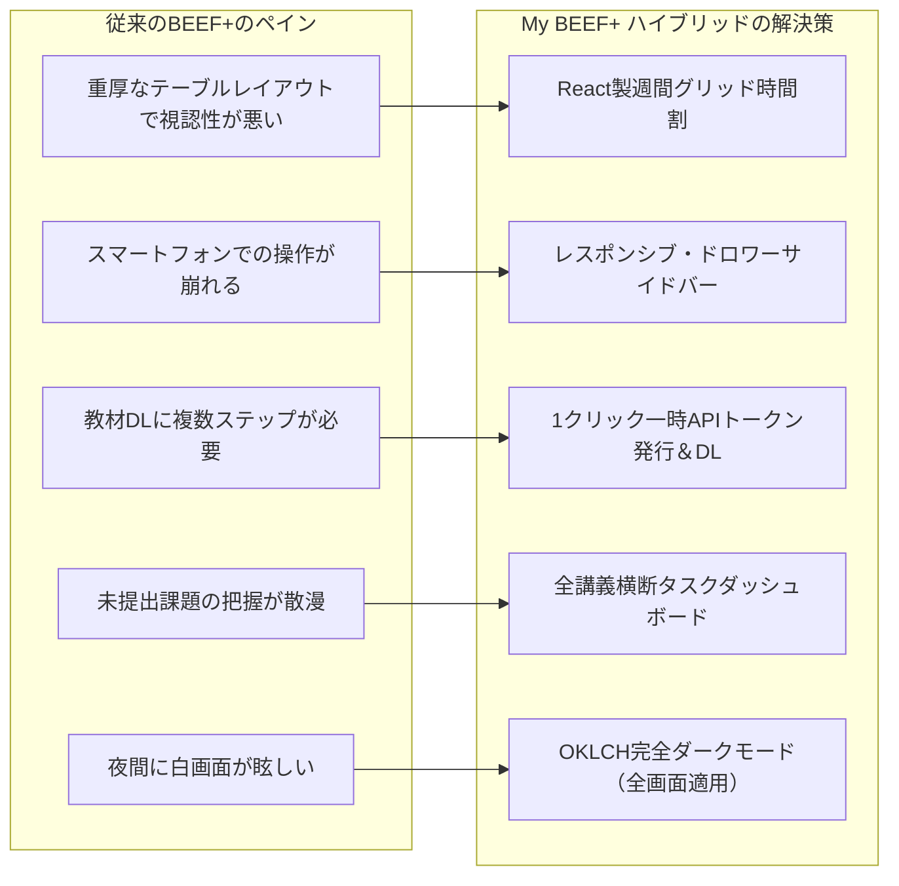
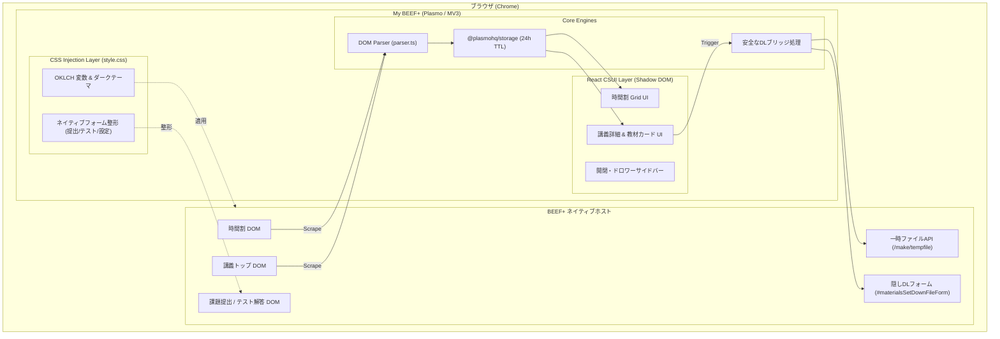
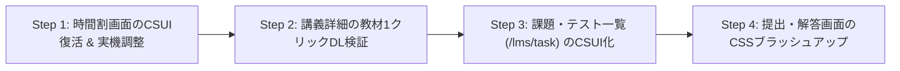

# 製品要求仕様書 (Product Requirements Document: PRD)

**プロダクト名**: My BEEF+ (`my-beef-plus`)  
**開発方針**: **ハイブリッド方式（情報閲覧・集約の独自React UI ✕ 入力・提出系のCSSインジェクション）**  
**対象システム**: 神戸大学 学習管理システム（LMS）「BEEF+」  
**最終更新日**: 2026年11月4日  
**ステータス**: 策定・開発中 (v0.2.0: ハイブリッドアーキテクチャ移行)  
**作成者 / メンテナ**: Miyanber  

---

## 目次

1. [エグゼクティブサマリー & 基本方針](#1-エグゼクティブサマリー--基本方針)
2. [ハイブリッド設計戦略（画面別の責務分離）](#2-ハイブリッド設計戦略画面別の責務分離)
3. [ターゲットユーザー & ペルソナ](#3-ターゲットユーザー--ペルソナ)
4. [解決する課題 & 提供価値](#4-解決する課題--提供価値)
5. [システムアーキテクチャ & 技術スタック](#5-システムアーキテクチャ--技術スタック)
6. [機能要件 (Functional Requirements)](#6-機能要件-functional-requirements)
   - 6.1 【独自UI】時間割（Timetable）画面
   - 6.2 【独自UI】講義トップ・教材一覧 & 1クリックDL
   - 6.3 【独自UI】未提出タスク・課題一覧ダッシュボード
   - 6.4 【独自UI】レスポンシブサイドバー & ナビゲーション
   - 6.5 【CSSインジェクション】課題提出・テスト解答・フォーム画面群
   - 6.6 スクレイピング & キャッシュエンジン (`lib/parser.ts`, `lib/utils.ts`)
7. [UI/UX & デザインシステム](#7-uiux--デザインシステム)
8. [非機能要件 (安全性・パフォーマンス・プライバシー)](#8-非機能要件-安全性パフォーマンスプライバシー)
9. [開発ステップ & 段階的移行ロードマップ](#9-開発ステップ--段階的移行ロードマップ)
10. [開発環境 & 運用手順](#10-開発環境--運用手順)

---

## 1. エグゼクティブサマリー & 基本方針

### 1.1 プロダクト概要
**My BEEF+ (`my-beef-plus`)** は、神戸大学の公式LMS「**BEEF+**」（および BEEF+ Venture）のUI/UXを刷新し、学生の学習効率と操作性を飛躍的に高めるブラウザ拡張機能（Chrome Extension）です。

### 1.2 コア設計思想：『ハイブリッド・アーキテクチャ』
初期開発では「全画面の独自React化」を試みるもパース工数とネイティブフォーム連携の複雑化に直面し、一時「CSSインジェクション単体」への切り替えを検討しました。しかし、CSSのみでは「モバイル対応」「講義を横断した課題集約」「Notion/Linear級のグリッドUI」を実現できないという構造的限界が存在します。

そこで本プロダクトでは、両者の強みを融合した**ハイブリッド方式**を採用します。

> [!IMPORTANT]
> **【ハイブリッド方針の原則】**
> 1. **「閲覧・検索・集約」が主のダッシュボード画面**:  
>    DOMスクレイピング ＋ Plasmo Content Script UI（React + Tailwind CSS + shadcn/ui）により、**圧倒的なデザインと利便性**を実現する。
> 2. **「入力・ファイル送信・テスト解答」を伴う重要トランザクション画面**:  
>    無理にReactで再実装せず、**既存のネイティブDOMを生かしたCSSインジェクション**により、モダンなデザイン（フォント・配色・ダークモード）を適用しつつ**100%の動作安全性（提出漏れ・送信バグのリスク排除）**を担保する。

---

## 2. ハイブリッド設計戦略（画面別の責務分離）

| 画面種別 | 対象URLパターン | 採用方式 | 理由・実装方針 |
| :--- | :--- | :--- | :--- |
| **時間割画面** | `/lms/timetable*` | **独自React UI (CSUI)** | 曜日×時限のデータ構造が明確。グリッド表示・講義カード・検索絞り込みなど、独自UI化によるUX向上が最大。 |
| **講義トップ・教材一覧** | `/lms/course?idnumber=...` | **独自React UI (CSUI)** | シラバス概要、授業情報、お知らせ、教材カードを再構築。内部API連携により**1クリック資料ダウンロード**を実現。 |
| **未提出課題一覧** | `/lms/task*` | **独自React UI (CSUI)** | 全講義から締切が迫った課題・小テストを集約・ソート。Next.jsプロトタイプを活用し独自UI化。 |
| **課題提出フォーム** | `/lms/course/report/submission*` | **CSSインジェクション** | ファイルアップロード、コメント入力、確認ダイアログ等の送信処理の安全性を100%保証するためネイティブ動作を維持。 |
| **小テスト・クイズ解答** | `/lms/course/quiz/take*` | **CSSインジェクション** | ラジオボタン選択、タイマーカウントダウン、送信処理の確実性を担保。 |
| **教員メッセージ送信** | `/lms/message/*` | **CSSインジェクション** | 問い合わせ作成モーダルやフォームをCSSでクリーンに整形。 |
| **共通レイアウト・ヘッダー** | 全体（`/lms/*`, `/portal/*`） | **ハイブリッド連携** | サイドバーはReact製ドロワー/開閉バーを提供。ネイティブ側の余白（`.page-main`）をCSSで追従調整。 |

---

## 3. ターゲットユーザー & ペルソナ

- **主対象**: 神戸大学の学部生、大学院生（全学部）
- **代表ペルソナ**:
  - 毎日の講義前にスマホやPCで時間割を確認し、教材PDFを素早くダウンロードしたい学生。
  - 課題の提出締切を忘れるリスクに不安を感じており、一目で残りタスクを把握したい学生。
  - 夜間のレポート作成時にダークモードを利用したい学生。

---

## 4. 解決する課題 & 提供価値



---

## 5. システムアーキテクチャ & 技術スタック

### 5.1 全体アーキテクチャ



### 5.2 技術スタック選定
- **拡張機能基盤**: Plasmo Framework (0.90.5) / Manifest V3
- **プロトタイピング環境**: Next.js 16 (App Router) + React 19
- **UIライブラリ**: React 18, Tailwind CSS (3.4), shadcn/ui (`@base-ui/react`), Lucide React
- **テーマ**: `next-themes` (Light / Dark / System)
- **データ永続化**: `@plasmohq/storage` (`chrome.storage.local`)
- **言語**: TypeScript 5.3 / 5.7

---

## 6. 機能要件 (Functional Requirements)

### 6.1 【独自UI】時間割（Timetable）画面 (`/lms/timetable*`)
- **週間マトリクス表示**:
  - 月〜金 × 1〜6時限のグリッド。
  - 各講義カード: 科目名、担当教員、講義カラー（科目コード/IDのハッシュによる決定論的6色）、リンク遷移（`/lms/course?idnumber=...`）。
  - 同一科目・複数コマ（連続コマや週2回講義）の自動マッピング。
- **操作ツールバー**:
  - 開講年度選択（2026 / 2025 / 2024）。
  - 講義名・科目コードでのインクリメンタル検索絞り込み。
  - キャッシュ手動強制再取得ボタン（リロード）。

### 6.2 【独自UI】講義トップ・教材一覧 & 1クリックDL (`/lms/course*`)
- **コース概要 & 授業情報**:
  - シラバス概要、Quillリッチテキストによる授業案内・Teamsリンク等の表示。
- **教材・講義資料ブロック**:
  - 第1回〜第15回などのセクション別カード表示。
  - **1クリック教材ダウンロード**:
    - 資料リンククリック時、`/lms/course/make/tempfile` を叩いて認証トークンを取得。
    - 取得した `fileId` を `#materialsSetDownFileForm` に設定して強制サブミット。
    - 不要なダイアログを全廃し、ダイレクトにブラウザダウンロードを開始。
- **お知らせ・メッセージ・掲示板サマリー**:
  - 最新の連絡事項をカード形式で整理。

### 6.3 【独自UI】未提出タスク・課題一覧ダッシュボード (`/lms/task*`)
- **全講義横断タスクビュー**:
  - 講義名、タスク種別（レポート・小テスト・アンケート）、課題名、提出期限を表示。
  - 締切順ソート、期限間近（24時間以内 / 3日以内）のバッジ強調表示。
  - クリックでネイティブ提出画面へダイレクト遷移。

### 6.4 【独自UI】レスポンシブサイドバー & ナビゲーション
- **PC表示**: 幅280px / 幅80px（折りたたみ）のスムーズな開閉。状態はストレージ保存。
- **モバイル表示**: ヘッダーのハンバーガーボタンから開くスライドインドロワー（Sheet）。
- **テーマ切替**: ヘッダーのトグルボタンで即座にLight/Dark切り替え（全画面連動）。

### 6.5 【CSSインジェクション】課題提出・テスト解答・フォーム画面群
- **ネイティブDOMの保護と美化**:
  - 課題提出フォーム（ファイル添付、テキストエリア、提出確認ダイアログ）、テスト解答画面、教員へのメッセージ送信画面は**オーバーレイで隠さずネイティブのまま表示**。
  - [`style.css`](file:///c:/Users/Miyanber/Desktop/dev/repos/my-beef-plus/plasmo/src/style.css) により、ボタン、インプット、テキストエリア、テーブル、文字フォント、背景色をモダンに上書き。
  - ダークモード時も完全なコントラスト比を確保。

### 6.6 スクレイピング & キャッシュエンジン (`lib/parser.ts`, `lib/utils.ts`)
- **非同期要素待機 (`waitForSelector`)**:
  - MutationObserver を用いて、Quillエディタや非同期フォームの描画完了を確実に待機。
- **TTLキャッシュ制御 (`executeIfExpired`)**:
  - パースした時間割・講義データを `chrome.storage.local` に保存。
  - キャッシュ有効期間: **24時間**。
  - キャッシュが存在する場合は即座にReact UIを描画し、体感ロード時間0msを実現。

---

## 7. UI/UX & デザインシステム

- **デザイン言語**: Linear / Notion ライクなクリーン・モダンUI
- **タイポグラフィ**: `Inter`, `Noto Sans JP`, システムUIフォント
- **カラートークン (OKLCH)**:
  - ライト: 背景 `#f7f8f9` / サーフェス `#ffffff` / プライマリ `oklch(0.44 0.11 268)`
  - ダーク: 背景 `#121212` / サーフェス `#1e1e1e` / プライマリ `oklch(0.922 0 0)`
  - 講義カラー（6色）: `violet`, `blue`, `sky`, `amber`, `rose`, `teal`。科目コード/IDの文字列ハッシュ（31乗算ハッシュ）から決定論的に割り当て、同一科目の色の一貫性と隣接セルの視認性を両立。
- **Shadow DOM スタイリング**:
  - `:root` ➔ `:host(plasmo-csui)` 置換
  - `rem` ➔ `px` 動的変換（16pxベース）
  - `ThemeBridge` によるShadow DOM内外のテーマクラス同期

---

## 8. 非機能要件 (安全性・パフォーマンス・プライバシー)

1. **提出事故ゼロの安全性 (Zero Risk Principle)**:
   - 課題提出やテスト送信処理はネイティブの送信機構を100%保持するため、拡張機能起因の提出失敗・単位取得への悪影響を完全に排除する。
2. **高速性**:
   - キャッシュによるミリ秒単位のダッシュボード描画。
3. **プライバシー**:
   - 外部サーバーへの通信は一切行わず、すべてのデータは端末ローカル（`chrome.storage.local`）にのみ保存。
4. **堅牢性**:
   - 大学側のHTML改修によりスクレイピングが失敗した場合でも、即座にネイティブDOMを表示するフォールバック機構を導入。

---

## 9. 開発ステップ & 段階的移行ロードマップ



- **Step 1: 時間割画面（Timetable）のCSUI復活 & 実機調整**
  - `timetable.tsx` の早期リターンを解除。
  - 実機の時間割HTMLに対してパースが100%成功するか検証し、微修正。
- **Step 2: 講義詳細（Course）の教材1クリックDL検証**
  - `course.tsx` の早期リターンを解除。
  - 資料ダウンロードAPI連携（`/make/tempfile`）の動作確認。
- **Step 3: 課題・テスト一覧（Task）のCSUI化**
  - Next.js側で作成済みのタスク一覧コンポーネントをPlasmoへ移植し、`/lms/task` にオーバーレイ。
- **Step 4: 提出・解答画面のCSSブラッシュアップ**
  - 提出画面・テスト画面のネイティブDOMに対するCSSを微調整し、ダークモードやボタン装飾を完成させる。

---

## 10. 開発環境 & 運用手順

### 開発起動
```bash
# 拡張機能
cd plasmo
pnpm install
pnpm dev

# Webプロトタイプ
cd next
pnpm install
pnpm dev
```

### デバッグモード
- キャッシュを無効化して毎回スクレイピングを実行する場合:
  `plasmo/.env` に `PLASMO_PUBLIC_DEBUG="True"` を設定。
