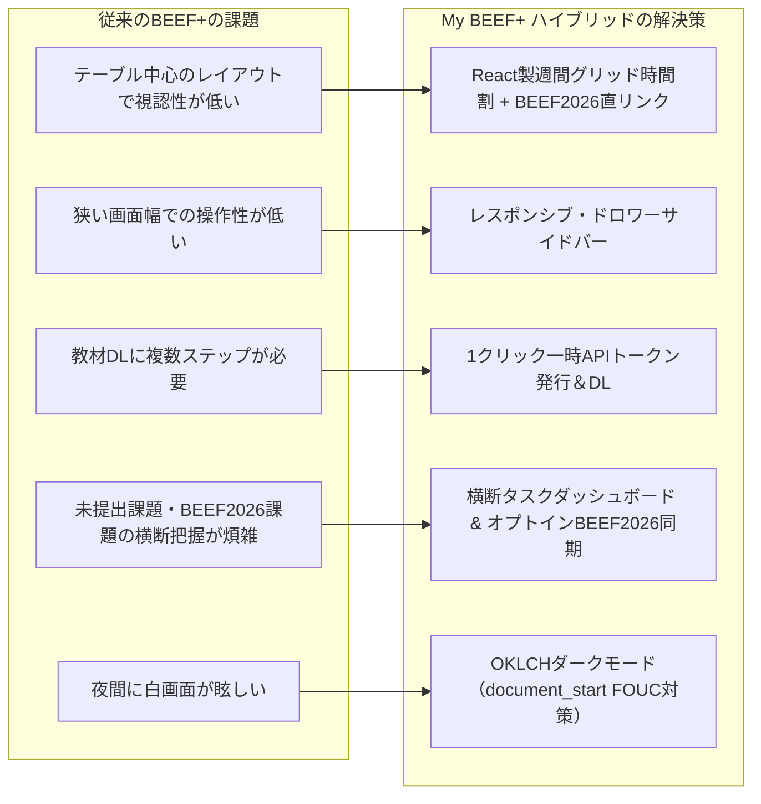
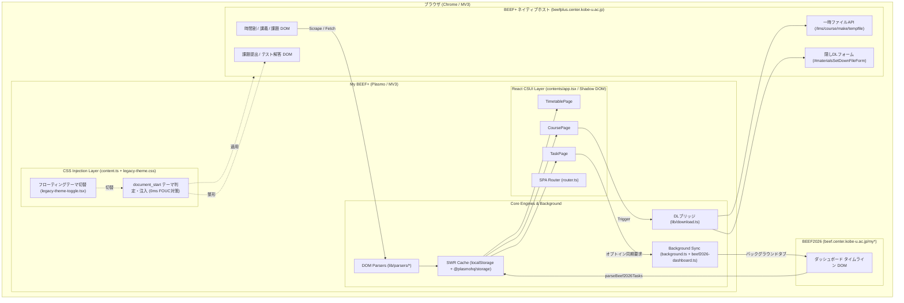
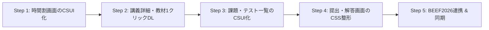

# 製品要求仕様書 (Product Requirements Document: PRD)

**プロダクト名**: My BEEF+ (`my-beef-plus`)  
**開発方針**: **ハイブリッド方式（情報閲覧・集約の独自 React UI × 入力・提出系の CSS インジェクション）**  
**対象システム**: 神戸大学 学習管理システム（LMS）「BEEF+」（および BEEF2026 連携）  
**最終更新日**: 2026年11月17日  
**ステータス**: 実装済み・公開準備完了 (v1.0.0)  
**作成者 / メンテナ**: Miyanber  

---

## 目次

1. [エグゼクティブサマリー & 基本方針](#1-エグゼクティブサマリー--基本方針)
2. [ハイブリッド設計戦略（画面別の責務分離）](#2-ハイブリッド設計戦略画面別の責務分離)
3. [ターゲットユーザー & ペルソナ](#3-ターゲットユーザー--ペルソナ)
4. [解決する課題 & 提供価値](#4-解決する課題--提供価値)
5. [システムアーキテクチャ & 技術スタック](#5-システムアーキテクチャ--技術スタック)
6. [機能要件 (Functional Requirements)](#6-機能要件-functional-requirements)
   - 6.1 【独自UI】時間割（Timetable）画面
   - 6.2 【独自UI】講義トップ・教材一覧 & 1クリックDL
   - 6.3 【独自UI】未提出タスク・課題一覧ダッシュボード & BEEF2026 同期
   - 6.4 【独自UI】レスポンシブサイドバー & ナビゲーション
   - 6.5 【CSSインジェクション】課題提出・テスト解答・フォーム画面群
   - 6.6 スクレイピング・SPA ルーター & SWR キャッシュエンジン
7. [UI/UX & デザインシステム](#7-uiux--デザインシステム)
8. [非機能要件 (安全性・パフォーマンス・プライバシー)](#8-非機能要件-安全性パフォーマンスプライバシー)
9. [開発マイルストーン & 実装状況](#9-開発マイルストーン--実装状況)
10. [開発環境 & 運用手順](#10-開発環境--運用手順)

---

## 1. エグゼクティブサマリー & 基本方針

### 1.1 プロダクト概要
**My BEEF+ (`my-beef-plus`)** は、神戸大学の公式 LMS「**BEEF+**」の UI/UX を刷新し、学生の学習効率と操作性を高める非公式ブラウザ拡張機能（Google Chrome Extension / Manifest V3）です。

### 1.2 コア設計思想：『ハイブリッド・アーキテクチャ』
初期検討では「全画面の独自 React 化」や「CSS インジェクション単体」も比較しましたが、前者ではフォーム送信・提出系の安全性担保が複雑化し、後者では「モバイル対応」「講義を横断した課題集約」「モダンなグリッド UI」を実現できないという限界がありました。

そこで本プロダクトでは、両者の強みを融合した**ハイブリッド方式**を採用しています。

> [!IMPORTANT]
> **【ハイブリッド方針の原則】**
> 1. **「閲覧・検索・集約」が主のダッシュボード画面**:  
>    DOM スクレイピング ＋ Plasmo Content Script UI（React + Tailwind CSS + shadcn/ui）により、**高い視認性と快適な操作性**を実現する。
> 2. **「入力・ファイル送信・テスト解答」を伴う重要トランザクション画面**:  
>    React で再実装せず、**既存のネイティブ DOM を生かした CSS インジェクション**により、モダンなデザイン（配色・ダークモード・レスポンシブ補助）を適用しつつ**動作安全性（提出漏れ・送信バグのリスク排除）**を担保する。

---

## 2. ハイブリッド設計戦略（画面別の責務分離）

| 画面種別 | 対象 URL パターン | 採用方式 | 理由・実装方針 |
| :--- | :--- | :--- | :--- |
| **時間割画面** | `/lms/timetable*` | **独自 React UI (CSUI)** | 曜日×時限の構造が明確。グリッド表示・集中講義表示・検索絞り込み・BEEF2026 直リンクなど UX 向上効果が最大。 |
| **講義トップ・教材一覧** | `/lms/course?idnumber=...` | **独自 React UI (CSUI)** | シラバス概要、授業情報、お知らせ詳細モーダル、教材カードを再構築。内部 API 連携により **1 クリック資料ダウンロード**を実現。 |
| **未提出課題一覧** | `/lms/task*` | **独自 React UI (CSUI)** | 全講義の未提出課題・小テスト・アンケートを集約・締切ソート。オプトインで **BEEF2026 ダッシュボード課題**も統合表示。 |
| **課題提出フォーム** | `/lms/course/report/submission*` | **CSS インジェクション** | ファイルアップロード、コメント入力、確認ダイアログ等の送信処理の安全性を 100% 保証するためネイティブ動作を維持。 |
| **小テスト・クイズ解答** | `/lms/course/quiz/take*` | **CSS インジェクション** | ラジオボタン選択、タイマーカウントダウン、送信処理の確実性を担保。 |
| **教員メッセージ送信** | `/lms/message/*` | **CSS インジェクション** | 問い合わせ作成モーダルやフォームを CSS でクリーンに整形。 |
| **ポータル・その他設定** | `/portal/*`, その他 `/lms/*` | **CSS インジェクション + トグル** | `legacy-theme.css` によるダークモード適用とフローティングのテーマ切替ボタン (`legacy-theme-toggle.tsx`) を提供。 |
| **BEEF2026 ダッシュボード** | `beef.center.kobe-u.ac.jp/my*` | **データ取得専用 CS** | オプトイン有効時のみタイムライン DOM から課題締切を取得（UI 変更は行わない）。 |

---

## 3. ターゲットユーザー & ペルソナ

- **主対象**: 神戸大学の学部生、大学院生（全学部）
- **代表ペルソナ**:
  - 毎日の講義前に PC や小型タブレット等で時間割を確認し、教材 PDF を素早くダウンロードしたい学生。
  - BEEF+ と BEEF2026 を併用する中で、課題の提出締切を一目で把握したい学生。
  - 夜間の課題作業時にダークモードを利用したい学生。

---

## 4. 解決する課題 & 提供価値



---

## 5. システムアーキテクチャ & 技術スタック

### 5.1 全体アーキテクチャ



### 5.2 技術スタック選定
- **拡張機能基盤**: Plasmo Framework (0.90.5) / Manifest V3
- **UI ライブラリ**: React 18, Tailwind CSS (3.4), shadcn/ui (`@base-ui/react`), Lucide React
- **テーマ**: `next-themes` (Light / Dark / System) + `legacy-theme.css`
- **データ永続化**: `@plasmohq/storage` (`chrome.storage.local`) + `localStorage`（0ms 同期キャッシュ）
- **言語**: TypeScript 5.3 (`strict: true`)

---

## 6. 機能要件 (Functional Requirements)

### 6.1 【独自UI】時間割（Timetable）画面 (`/lms/timetable*`)
- **週間マトリクス & その他講義表示**:
  - 月〜金 × 1〜6 時限のグリッドおよび集中講義等の表示。
  - 各講義カード: 科目名、科目コード、担当教員、講義カラー（科目コード等のハッシュによる決定論的 6 色）、講義詳細への SPA 遷移（`/lms/course?idnumber=...`）。
  - **BEEF2026 直接リンク**: 科目に BEEF2026 URL が登録されている場合、カード右下に別タブで開くショートカットボタンを表示。
- **操作ツールバー (`control-bar.tsx`)**:
  - 開講年度選択・期間（クォーター/セメスター）選択、現在の時間割へのリセットボタン。
  - 授業名・科目コード・担当教員でのインクリメンタル検索絞り込み。

### 6.2 【独自UI】講義トップ・教材一覧 & 1クリックDL (`/lms/course?idnumber=...`)
- **コース概要 & 授業情報**:
  - シラバス概要、Quill リッチテキストによる授業案内等の表示。
  - **BEEF2026 連携 URL 設定**: `BeefUrlModal` により科目単位で BEEF2026 コース URL の登録・編集・解除が可能。
- **お知らせ・メッセージ・掲示板・課題・テスト・アンケート**:
  - お知らせクリック時に BEEF+ 本来のフォーム/詳細取得機構を通じてモーダルで本文を表示（`loadAnnouncementDetail`）。
  - 課題・テスト・アンケートはステータスや締切バッジ付きで一覧化し、提出・解答画面へ直接遷移可能。
- **教材・講義資料ブロック**:
  - セクション別のカード表示。
  - **1 クリック教材ダウンロード (`lib/download.ts`)**:
    - 資料クリック時に `/lms/course/make/tempfile` へリクエストして一時 `fileId` を取得。
    - 取得した `fileId` 等を `#materialsSetDownFileForm` に設定して送信し、直接ダウンロードを開始。

### 6.3 【独自UI】未提出タスク・課題一覧ダッシュボード (`/lms/task*`) & BEEF2026 同期
- **全講義横断タスクビュー**:
  - 講義名、タスク種別（課題・テスト・アンケート・その他）、タイトル、提出締切を表示。
  - 締切順ソートおよび緊急度バッジ（期限切れ / 本日締切 / 近日中 / 今週中 / 余裕あり）の強調表示。
  - タイトル検索・講義名フィルタ・種別フィルタ。
- **BEEF2026 ダッシュボード課題同期（オプトイン）**:
  - ヘッダーの「BEEF2026 同期」スイッチ（デフォルト OFF）を ON にすると、`background.ts` がバックグラウンドタブで `https://beef.center.kobe-u.ac.jp/my/` を開き、`beef2026-dashboard.ts` がタイムラインから課題・テスト締切を抽出して統合表示（クールダウン・タイムアウト・手動同期・LMS ソースフィルタ対応）。

### 6.4 【独自UI】レスポンシブサイドバー & ナビゲーション
- **PC 表示**: 幅 280px / 折りたたみ表示の切り替え（画面幅 `1500px` ブレークポイントによる初期値判定 + ユーザー手動設定の永続化）。
- **モバイル表示**: ヘッダーのハンバーガーボタンから開くスライドインドロワー（Sheet）。
- **テーマ切替**: ヘッダーのトグルボタンで Light / Dark を即座に切り替え（ネイティブ画面とも同期）。

### 6.5 【CSSインジェクション】課題提出・テスト解答・フォーム画面群
- **ネイティブ DOM の保護と美化**:
  - 課題提出フォーム、テスト解答画面、教員へのメッセージ送信画面、ポータル等は **React で覆わずネイティブ DOM のまま表示**。
  - [legacy-theme.css](../plasmo/src/legacy-theme.css) と [content.ts](../plasmo/src/content.ts) により、`document_start` 時点で配色・テーブル・ボタン・フォーム要素を整形し、FOUC なしのダークモードとモバイル向け `viewport` を適用。
  - [legacy-theme-toggle.tsx](../plasmo/src/contents/legacy-theme-toggle.tsx) によりネイティブ画面右上にもテーマ切替ボタンを配置。

### 6.6 スクレイピング・SPA ルーター & SWR キャッシュエンジン
- **URL ルーティング (`lib/router.ts`)**:
  - `parseRoute()` により独自 UI 対象ルート（`timetable`, `course`, `task`）とネイティブルート（`native`）を判定。
  - 独自 UI 間のクリックは `setupGlobalLinkInterceptor()` が横取りし、リロードなしの SPA 遷移を実行するとともに裏で `#contentsWrapper` および `#informationDtl` を最新ページ DOM に同期。
- **SWR キャッシュ (`lib/use-page-data.ts`, `lib/storage-cache.ts`)**:
  - `localStorage` の同期キャッシュで遷移直後 0ms の描画を実現しつつ、バックグラウンドで DOM 解析または `fetch` 再検証を行い最新状態へ更新。
  - スクレイピング失敗時は `setNativeHidden(false)` により本来の BEEF+ 画面へフォールバック。

---

## 7. UI/UX & デザインシステム

- **デザイン言語**: クリーン・モダンなダッシュボード UI（shadcn/ui ベース）
- **タイポグラフィ**: `Inter`, システム UI / 日本語ゴシックフォント
- **カラートークン (OKLCH)**:
  - `plasmo/src/style.css` にてライト / ダーク用の OKLCH CSS 変数を定義。
  - 講義カラー（6 色）: `violet`, `blue`, `sky`, `amber`, `rose`, `teal`。科目コード等から決定論的ハッシュ (`pickCourseColor`) で割り当て。
- **Shadow DOM スタイリング (`lib/plasmo-style.ts`)**:
  - `:root` ➔ `:host(plasmo-csui)` 置換
  - `rem` ➔ `px` 動的変換（16px ベース）
  - `ThemeBridge` による Shadow DOM 内外（`document.documentElement`）の `dark` クラス同期

---

## 8. 非機能要件 (安全性・パフォーマンス・プライバシー)

1. **提出事故ゼロの安全性 (Zero Risk Principle)**:
   - 課題提出やテスト送信処理はネイティブの送信機構を 100% 保持し、拡張機能起因の提出失敗リスクを排除する。
2. **高速性**:
   - `localStorage` 同期キャッシュと SPA ナビゲーションによる即座の画面表示。
3. **プライバシー**:
   - 開発者等の外部サーバーへの送信は一切行わず、データはすべて端末ローカル（`chrome.storage.local` / `localStorage`）にのみ保存（詳細は [docs/PRIVACY.md](PRIVACY.md) 参照）。
4. **堅牢性**:
   - 大学側の HTML 改修によりスクレイピングが失敗した場合でも、即座にネイティブ DOM を再表示するフォールバック機構を備える。

---

## 9. 開発マイルストーン & 実装状況



- **Step 1〜4 (完了 / v1.0.0)**: 時間割・講義詳細（1 クリック DL・お知らせ詳細モーダル含む）・課題一覧・SPA ルーター・SWR キャッシュ・ネイティブ画面用 `legacy-theme.css` を実装済み。
- **Step 5 (完了 / v1.0.0)**: 時間割/講義画面での BEEF2026 コース URL 設定・直接リンク、および課題一覧でのオプトイン式 BEEF2026 バックグラウンド課題同期を実装済み。

---

## 10. 開発環境 & 運用手順

```bash
cd plasmo
pnpm install

# 開発ビルド（ホットリロード）
pnpm dev

# 型チェック
pnpm tsc --noEmit

# 本番ビルド / パッケージング
pnpm build
pnpm package
```
